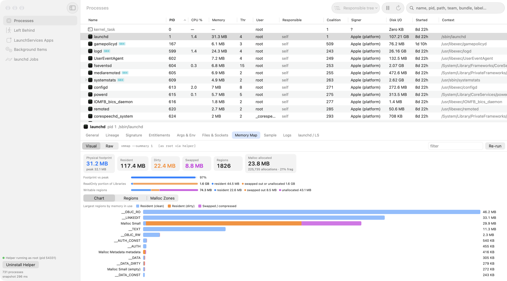
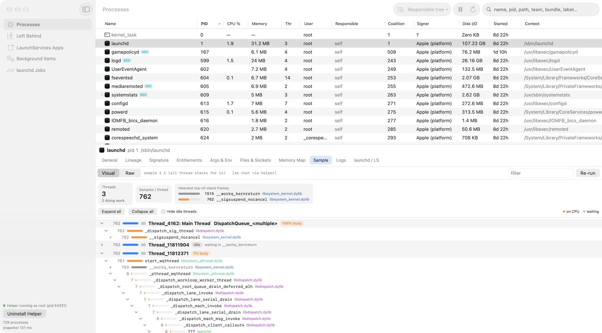
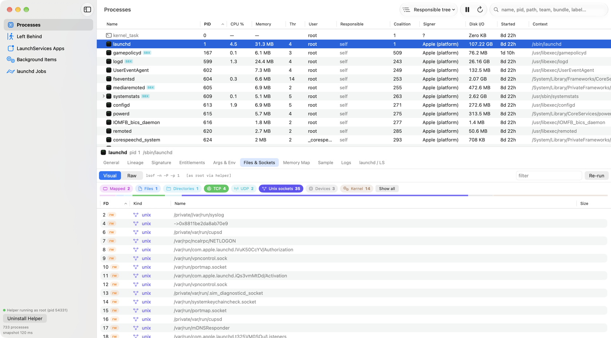
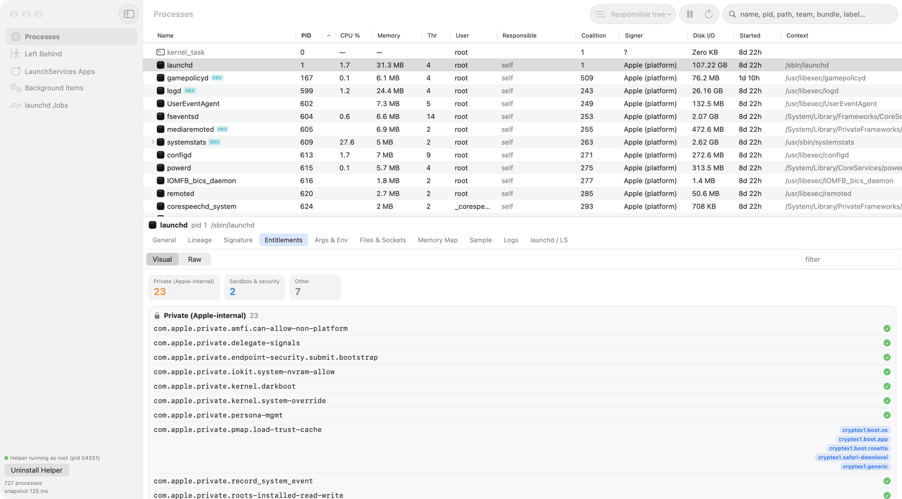
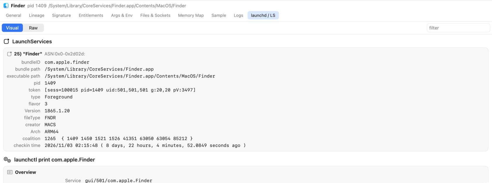

# ProcXRay

A Process Hacker–style process explorer for macOS that surfaces the attribution data macOS itself uses: responsible processes, coalitions, LaunchServices state, code signatures, launchd jobs and Background Task Management records.

## Screenshots

Process tree with the inspector on `launchd`, showing `vmmap --summary` parsed into footprint tiles, memory-portion bars and a per-region chart:



`sample` as a collapsible call tree: busy threads in orange, waits in grey, libraries colour-coded:



`lsof` as a typed, filterable table (here filtered to Unix and TCP sockets):



Entitlements grouped into Apple-private, sandbox/security and other:



`lsappinfo` and `launchctl print` rendered as cards:



Every pane has a **Visual / Raw** switch to see the tool's original text.

## Build & run

```bash
./build-app.sh
open build/ProcXRay.app
```

Requires full Xcode (`/Applications/Xcode.app`). The Command Line Tools SDK for macOS 27 lacks the SwiftUI macro plugin, so `@State` fails to compile with it.

`build-app.sh` signs with the first "Apple Development" identity in your keychain (override with `SIGN_ID=…`). It also rewrites the binary's recorded SDK version with `vtool`: SwiftPM records sdk = deployment target (14.0), which makes AppKit run the app in macOS 14 compatibility mode (opaque toolbar, thicker split divider and a visible kink where the sidebar meets the toolbar).

The app icon (a chip under an X-ray scan beam) is drawn in code by `tools/make-icon.swift`; regenerate `Resources/AppIcon.icns` with `swift tools/make-icon.swift Resources`.

## Privileged helper

The sidebar's **Install Privileged Helper…** button registers a root daemon through `SMAppService.daemon`. macOS asks you to approve it once under System Settings → General → Login Items. The helper is the same binary started by launchd as `ProcXRay --helper`.

- **Read-only.** It returns task metrics for every pid and args/env/cwd for a pid, and runs a fixed allowlist of tools whose command lines it builds itself: `lsof`, `vmmap --summary`, `sample`, `launchctl procinfo` and `sfltool dumpbtm`. It never accepts paths, commands or free-form arguments.
- **Mutual code-signing check.** The helper's XPC listener only accepts `local.procxray` signed by the same team (`setConnectionCodeSigningRequirement`), and the app only talks to a helper with that identity. The team ID is read from the binary's own signature at runtime.
- **Exits when idle.** It quits about 10 s after the last connection closes, and launchd restarts it on demand.
- With the helper running, root-owned processes show memory, CPU, threads and arguments, and Background Items loads without a password prompt. `vmmap`/`sample` still cannot inspect Apple platform binaries (SIP).

## What it shows

- **Processes**: parent tree, responsible tree (dead responsible apps appear as `†` groups), coalition groups, or flat. Columns cover CPU, physical footprint, threads, user, responsible process, coalition, signer, disk I/O and age; badges mark LEFT (responsible gone), ZOMBIE, ROSETTA, SBX (sandboxed) and EXITED.
- **Inspector**: General, Lineage (parent chain, children, processes it is responsible for, coalition members), Signature (team, authority chain, CDHash, static and runtime CS flags), Entitlements, Args & Env, Files & Sockets (`lsof`), Memory Map (`vmmap --summary`), Sample (`sample`, 1 s), Logs (`/usr/bin/log`, filtered to the pid), launchd/LaunchServices.
- **Visual / Raw**: every tool-backed pane is parsed (`Sys/Parsers.swift`) and drawn visually (`UI/Visualizers.swift`): lsof as a typed, filterable socket/file table with TCP state badges; vmmap as footprint tiles, portion bars, a region bar chart and sortable region/malloc-zone tables; sample as a collapsible call tree with per-thread busy/idle summaries; logs as a level-stacked event histogram plus table; launchctl print/procinfo and lsappinfo as cards; entitlements grouped into private / sandbox / other. A Visual/Raw switch (remembered app-wide) shows the original text, and output that can't be parsed (errors, permission notes) falls back to it automatically.
- **Left Behind**: processes that keep an app in the "running in background" state after it quits. Detected two ways: a responsible pid that no longer exists, and LaunchServices entries marked `exited-with-subordinates`, matched through their coalition and related pids.
- **LaunchServices Apps**: parsed `lsappinfo list`, including coalition members and related pids.
- **Background Items**: parsed `sfltool dumpbtm`. Loaded only on request. Through the helper it runs as root with no prompt; without the helper, `sfltool` asks for an admin password on every run.
- **launchd Jobs**: `launchctl list` plus `launchctl print` for the selected job.

## Data sources

- `sysctl(KERN_PROC_ALL)`, `KERN_PROCARGS2`, `proc_pidpath`, `proc_pidinfo` (task info, vnode paths, coalition flavor 20), `proc_pid_rusage` v4
- `responsibility_get_pid_responsible_for_pid` and `sandbox_check` (private libsystem symbols resolved with `dlsym`)
- Security.framework `SecCodeCopyGuestWithAttributes` / `SecCodeCopySigningInformation`
- `lsappinfo`, `launchctl`, `sfltool`, `lsof`, `vmmap`, `sample`, `/usr/bin/log`

Runs unprivileged. Task info, arguments and environment are only readable for your own processes; root-owned ones show `—`.

## Notes

- `lsappinfo`'s `coalition:` field is the **jetsam** coalition id (resource id + 1), not the resource coalition.
- In zsh, `log` is a shell builtin that shadows `/usr/bin/log`. Always use the full path.
- `ProcXRay --dump [--pid N] [--btm]` prints a self-test snapshot for cross-checking against `ps` and `lsappinfo`. `--btm` triggers the password prompt.
- `ProcXRay --spawn-leftover` starts a detached `sleep 120` and exits, which reproduces the "app quit but a helper kept running" state.
